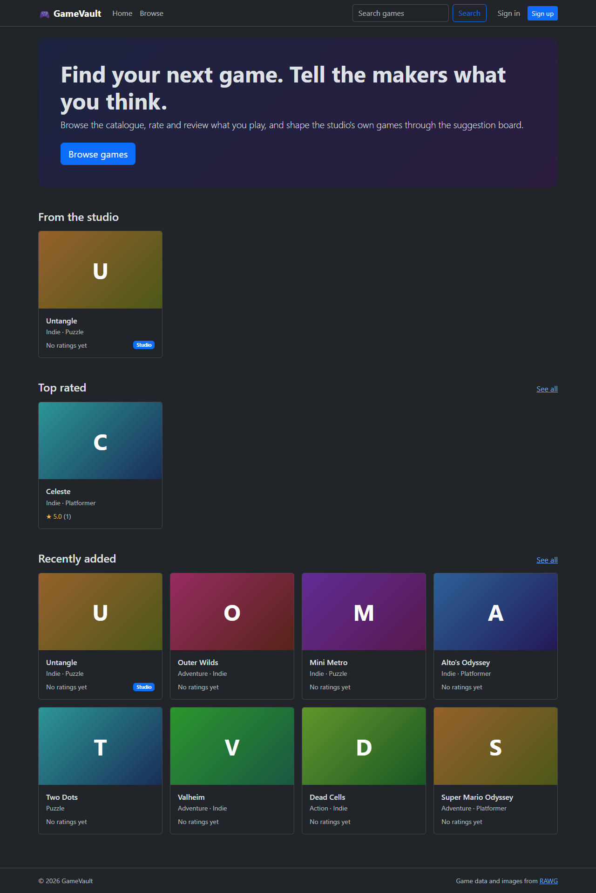
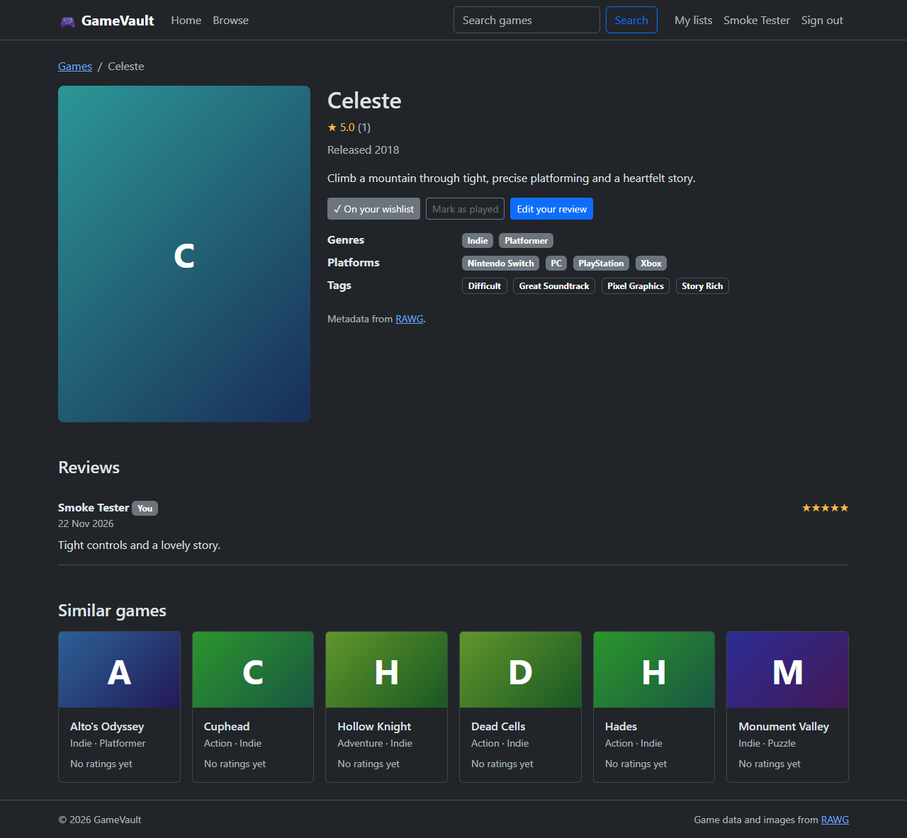
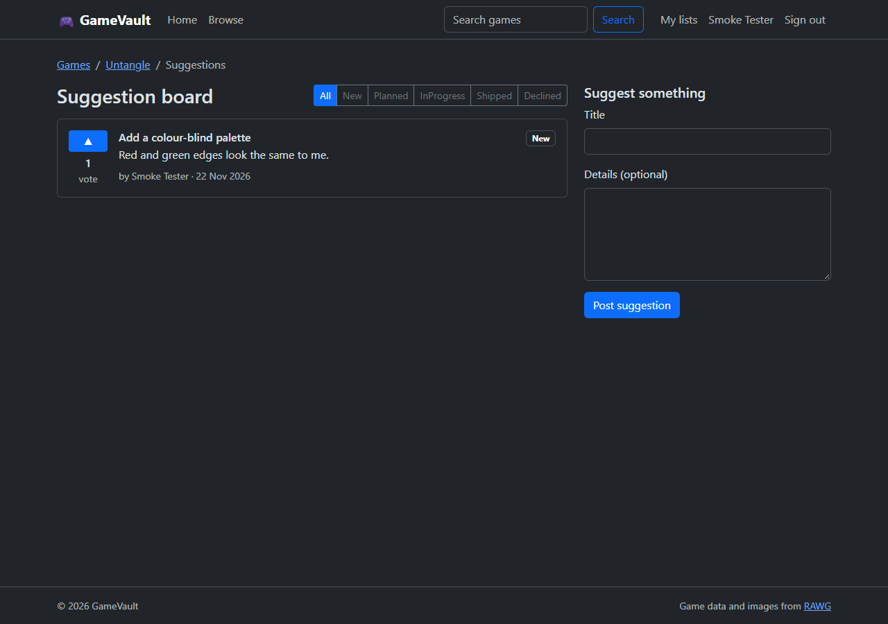
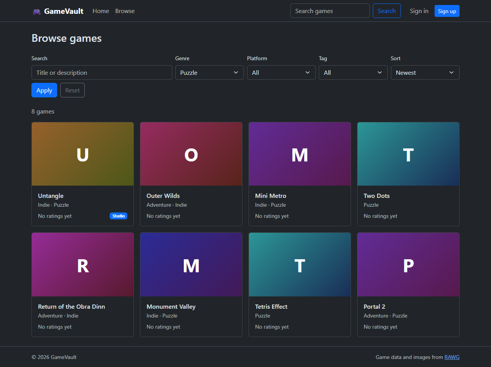
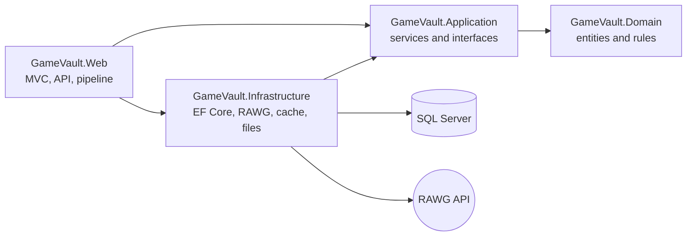

# GameVault


A public **ASP.NET Core MVC** site where visitors browse a game catalogue, rate and review games and keep wishlists, and where the studio's own games (Untangle first) get a built-in feedback loop: a suggestion board with votes, and an API the Unity builds post player feedback to. It doubles as a portfolio piece for MVC, API integration, security and performance work.

**Live demo:** not deployed yet. The host is chosen on the day; the checklist is in [docs/DEPLOYMENT.md](docs/DEPLOYMENT.md).

| | |
|---|---|
|  |  |
|  |  |

## What it does

- **Catalogue:** search, filter by genre, platform and tag, sort, page; a game page with screenshots, rating summary, reviews and similar games; games imported from RAWG (a free games API) behind an interface, with retries, a circuit breaker and a monthly request budget.
- **Community:** accounts with Member, Moderator and Admin roles; 1 to 5 star reviews with one per member per game; wishlist and played lists; reporting and a moderation queue.
- **Studio hub (Admin):** create and edit the studio's own games with uploads; a suggestion board where members post and upvote and the studio sets the status; a feedback inbox with filters and CSV export; API keys; a dashboard with feedback per app version.
- **Feedback API:** `POST /api/v1/feedback` with a per-game key, rate limited, with problem-details errors.

## Run it

Needs the .NET 10 SDK and a SQL Server (the local SQL Express works).

```powershell
dotnet run --project src/GameVault.Web     # migrates and seeds 31 sample games on first start in Development
dotnet test                                # about 350 tests in 15 seconds
```

Everything configurable, with the first-admin and RAWG setup, is in [docs/GUIDE.md](docs/GUIDE.md).

## Architecture

Four projects with dependencies pointing inward, so business rules never depend on EF Core, RAWG or MVC.



Repository, Strategy, Decorator, Factory, Observer and Options each have a real use; the flows, data model and a pattern-to-file table are in [docs/ARCHITECTURE.md](docs/ARCHITECTURE.md).

## Quality

| | |
|---|---|
| **Tests** | About 350: unit, provider tests with a fake HTTP handler, integration tests on a real SQL Server (a throwaway database per test class), authorization tests for every protected route, security-header and page-crawl tests, query-count budgets, and a real-browser smoke suite |
| **Coverage** | Application layer: **100% of lines, 92% of branches** (CI fails below 70% of lines) |
| **CI** | Build with warnings as errors, all tests against a SQL Server container, coverage gate, Docker image build. Written but **not yet run on GitHub**: push the repository to see the first result |
| **Security** | Strict Content Security Policy with no inline code (checked in a real browser), HSTS, Secure cookies, anti-forgery on every POST, hashed API keys, content-checked uploads, CSV-injection-safe export ([guide](docs/GUIDE.md#security)) |
| **Performance** | On a synthetic 5,000-game catalogue, locally: first-page reads **1,190 to 147** and median **5 to 1 ms** with sort-matched indexes; **14 queries to 2** per card list; the cache lifts throughput **305 to 1,882 requests/s** and cuts p95 from **124 to 19 ms**; pages shrink **84%** with brotli ([full numbers](docs/PERFORMANCE.md)) |

## Skills demonstrated

OOP and SOLID with dependencies pointing inward; six design patterns used for real reasons; an API integration with resilience and a budget guard; ASP.NET Core MVC with Identity, named policies, a custom authentication scheme, rate limiting and health checks; security; testing at four levels; measured performance work including an optimisation that was tried and reverted; and [ten real bugs written up](docs/DEBUGGING.md) with how each was found. The mapping from each claim to the exact place it can be checked is in [docs/RESUME.md](docs/RESUME.md).

## Decisions

Eighteen short records in [docs/adr/](docs/adr/README.md): the thirteen from the spec (runtime, MVC, layout, SQL Server, Identity, in-process events, RAWG, resilience, caching, background work, testing, hosting, repository) and five made while building (strict CSP, reviews delete versus hide, search with LIKE, uploads, the feedback API).

## Status

| Milestone | State |
|---|---|
| M0 Setup, M1 Domain and data, M2 Catalogue | Done |
| M3 RAWG integration | Done, tested with a fake HTTP handler; **not yet run against the live RAWG API** |
| M4 Accounts and reviews | Done |
| M5 Studio feedback hub | Done; **a real Unity build has not sent a message yet** |
| M6 Harden and ship | Hardening, performance pass, docs and smoke tests done; **not deployed** |

## Known gaps

Stated plainly so nothing here is a surprise:

- **No live URL.** Nothing has been deployed, so the spec's "p95 under 300 ms on the deployed instance" is unmeasured. The k6 script is ready ([perf/catalogue.k6.js](perf/catalogue.k6.js)); locally the same pages answer in 19 ms at p95.
- **CI has not run on GitHub yet**, and the Docker image has not been built (Docker is not installed on the development machine).
- **Search uses `LIKE`, not full-text search.** The Full-Text feature is not installed on the development SQL Server Express; [docs/sql/fulltext.sql](docs/sql/fulltext.sql) is the untested setup for a server that has it ([ADR 16](docs/adr/0016-search-like-not-fulltext.md)).
- **RAWG has never been called for real** (no API key yet), including the smaller-image URLs, which fall back to the originals if wrong. RAWG's terms do not mention caching: confirm with them before the first bulk import.
- **The 1,000-game success criterion is untested:** the catalogue holds 31 seeded games until RAWG import is switched on; performance was measured on 5,000 synthetic ones.

## Documentation

[GUIDE](docs/GUIDE.md) (operating reference) · [ARCHITECTURE](docs/ARCHITECTURE.md) (diagrams, patterns) · [PERFORMANCE](docs/PERFORMANCE.md) (before and after numbers) · [DEBUGGING](docs/DEBUGGING.md) (real bugs) · [DEPLOYMENT](docs/DEPLOYMENT.md) (checklist) · [RESUME](docs/RESUME.md) (claims and bullets) · [ADRs](docs/adr/README.md)
