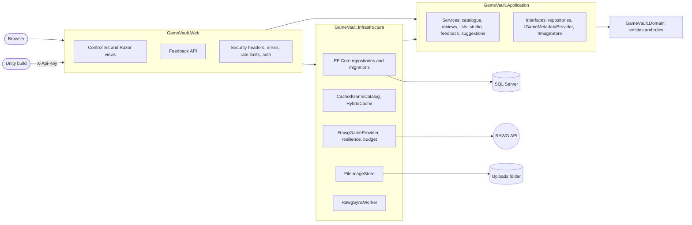
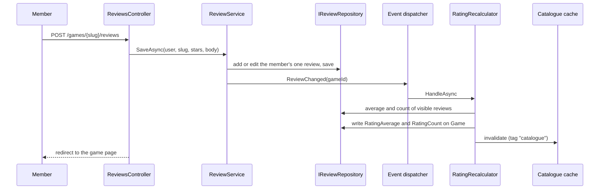
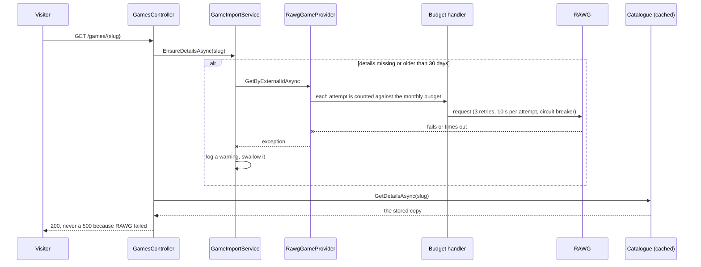
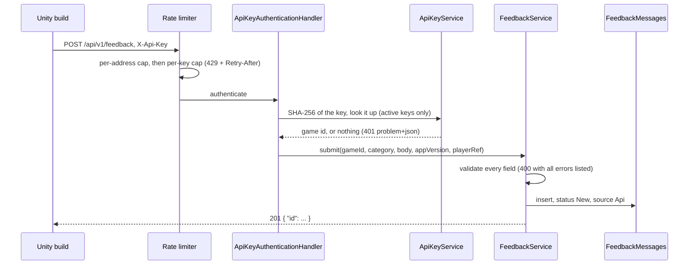
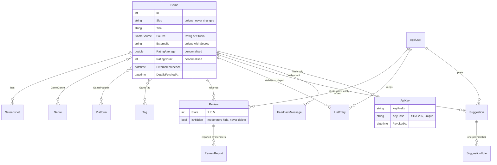

# Architecture

GameVault is four projects with dependencies pointing inward, so business rules never depend on EF Core, RAWG or MVC. This page shows the shape, the main flows, the data model and where each design pattern lives. The reasons behind the choices are in [adr/](adr/README.md).

## The layers

Dependency rule: `Domain` depends on nothing; `Application` depends only on `Domain`; `Infrastructure` implements the interfaces `Application` defines; `Web` wires everything together in `Program.cs` and `Infrastructure/DependencyInjection.cs`. Only `Infrastructure` talks to SQL Server, the file system and RAWG, so every service in `Application` is unit-tested with substitutes and no database.

## Flows

### A review changes a game's rating

The review code never mentions ratings: it raises an event and a handler reacts (the Observer pattern). List pages read the stored average and never aggregate reviews.

### A game page when RAWG is slow or down

### A Unity build sends feedback

The studio reads the same table in `/studio/inbox` next to feedback typed into the website.

### RAWG sync (nightly)

`RawgSyncWorker` waits a minute after start, then once a day calls `GameImportService.RunSyncAsync`: refresh the stalest rows first, then import the next pages of popular games, saving the page cursor in `SyncState`. It stops as soon as the month's sync budget (15,000 requests) is spent and leaves the rest of the 20,000 for on-demand fetches.

## Data model

Two more tables support the background job: `ApiUsage` (requests per provider per day, for the budget) and `SyncState` (the import cursor). Rules that hold across tables: all timestamps are UTC; a review is unique per (game, member); a vote is unique per (suggestion, member) and `VoteCount` is recounted from the vote rows in the same transaction; RAWG-sourced rows are a cache and carry `ExternalFetchedAt`.

## Where each design pattern lives

| Pattern | Where | Why |
|---|---|---|
| Repository | `IGameRepository`, `IReviewRepository`, `IListRepository`, `IStudioGameRepository`, `IFeedbackRepository`, `IApiKeyRepository`, `ISuggestionRepository` in `Application`; EF classes in `Infrastructure/Persistence` | Queries sit behind interfaces so services are tested with substitutes. `DbContext` is already a unit of work, so repositories exist only where a service needs one. |
| Strategy | `ISimilarityStrategy` and `TagOverlapSimilarity` (`Application/Catalogue`) | How "similar games" is computed can change without touching callers. |
| Decorator | `CachedGameCatalog` wraps `GameCatalog` (`Infrastructure/Caching`) | Caching stays out of business code and is removed by one registration line. |
| Factory | `GameMetadataProviderFactory` (`Application/Metadata/Contracts.cs`) | A second provider (IGDB) can be added without changing callers. |
| Observer | `IDomainEventDispatcher`, `ReviewChanged`, `SuggestionVoted`, `RatingRecalculator` (`Application/Events`, `Application/Reviews`) | The review code does not know that ratings exist. |
| Options | `RawgOptions`, `SyncBudgetOptions`, `UploadsOptions`, validated at startup | A bad setting fails at start, not on the first request. |
| Dependency injection | `Program.cs` and `Infrastructure/DependencyInjection.cs` | One place wires everything; every class gets its dependencies through its constructor. |

## Caching

`HybridCache` holds search results, game details, facets, the home page and similar games for five minutes, all under one tag. Anything that changes what a page shows (a review, a hide, a studio edit, an upload, a RAWG import) calls `InvalidateAsync`, which removes that tag. Per-visitor data (their lists, their review) is never cached: it is loaded beside the shared page model. Query counts per page are pinned by `QueryBudgetTests`.

## Security in the request pipeline

Order of middleware in `Program.cs`: request logging, security headers, error handling (a problem document for `/api`, a friendly page for the site), friendly status pages, compression, HTTPS redirect, uploads, routing, rate limiting, authentication, authorization. The Content Security Policy forbids inline script and style, which the code honours everywhere. Details and the reasons: ADR 14, 17 and 18, and the "Security" section of the README.

## Tests

| Level | Where | What it proves |
|---|---|---|
| Unit | `tests/GameVault.Tests/Unit` | Rules in `Application` and `Domain`, with substitutes: services, validation, CSV, keys, budget, health checks, image sniffing, file store |
| Provider | `Rawg/RawgProviderTests.cs` | Mapping, retries on 429 and 5xx, timeouts, the budget, with a fake HTTP handler |
| Integration | `tests/GameVault.Tests/Integration` | The real site over HTTP on a real SQL Server (a throwaway database per class): flows, authorization, security headers, query budgets |
